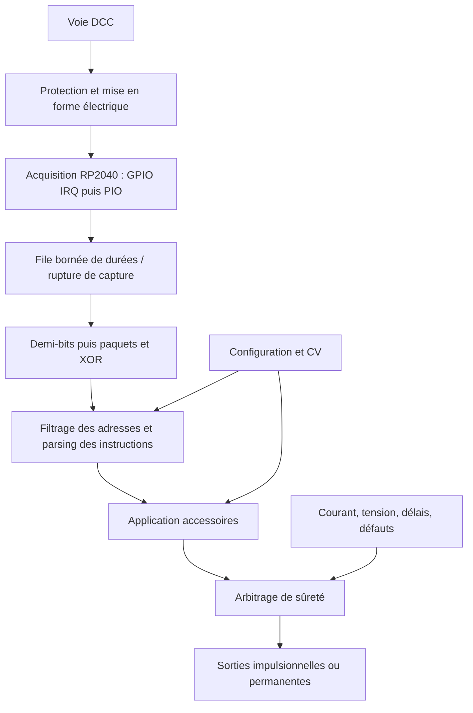

# Architecture du décodeur DCC

## Périmètre et décisions initiales

Le premier profil est un décodeur d’accessoires : aiguillages et éclairages.
Le cœur de réception reste réutilisable. Le nombre de sorties, les charges et
leur interface électrique seront définis avec la carte ; le profil locomotive
reste hors du premier périmètre.

- C++17, Raspberry Pi Pico SDK, bare metal, sans RTOS au départ.
- Cœur protocolaire portable, sans allocation, exception, accès matériel ou attente.
- Un seul cœur RP2040 utilisé. Le second reste disponible ; son activation
  nécessitera un autre contrat de synchronisation que celui du backend actuel.
- Traitement par boucle coopérative ; acquisition asynchrone et travail borné.
- Construction native pour les tests et construction embarquée séparées.
- Aucune commande de charge avant l’implémentation de la chaîne de sûreté.

La cible protocolaire est le DCC NMRA (S-9.1 pour le signal, S-9.2 et standards
associés pour les paquets, instructions et CV). Il faudra figer les éditions
et le sous-ensemble supportés avant une revendication de conformité.

## Flux des données

Les blocs jusqu’au décodeur existent dans le socle. Les blocs suivants sont
les frontières prévues, pas des fonctionnalités déjà disponibles.

## Organisation et contrats

| Module | Responsabilité et contrat |
| --- | --- |
| `include/dcc`, `src/dcc` — existant | Transformer des durées en paquets vérifiés. Un résultat `true` livre un paquet complet copié dans l’argument de sortie ; sinon cet argument reste inchangé. |
| `src/platform/rp2040` — existant | Horodatage, GPIO et transport des durées. Ne connaît ni adresse DCC ni commande moteur. |
| `protocol` — à créer | Identifier les paquets d’accessoires de base, leur adresse, leur sortie, leur direction et leur activation. Traiter explicitement reset, idle et broadcasts selon le standard retenu ; ignorer les paquets locomotive et les formats non supportés. |
| `application` — à créer | Mapper les adresses vers les sorties et gérer impulsions, états permanents, répétitions et interverrouillages. Aucun registre matériel dans cette couche. |
| `configuration` — à créer | Lire les CV, vérifier les valeurs, fournir une configuration cohérente et gérer les valeurs par défaut. |
| `safety` — à créer | Prioriser défaut matériel, arrêt d’urgence et perte de commandes ; autoriser ou inhiber les sorties. |
| `drivers` — à créer | Réaliser uniquement les consignes autorisées : sorties de bobines, éclairage, PWM éventuel et mesures de défaut. |
| `diagnostics` — à étendre | Exposer compteurs et défauts sans attente ni journalisation dans les interruptions. |

Le protocole produira notamment `SetAccessory` (adresse, sortie, direction,
activation), puis `WriteCv` lorsque la programmation sera implémentée.
Un arrêt local de sûreté restera distinct des commandes DCC et ne sera pas
déduit d’une instruction locomotive. L’application recevra un temps
monotone explicite pour permettre les tests des délais sur PC. Les commandes
adressées à un autre décodeur et les paquets idle ne rafraîchiront pas les
délais de commande d’une charge locale.

## Acquisition et réception

### Backend initial par interruptions

Le GPIO déclenche sur les deux fronts. L’ISR enregistre la différence entre
deux horodatages `time_us_32()` et la place dans une file statique de 256 cases
(255 utilisables). Le premier front initialise l’horodatage et n’est pas livré.
Les soustractions non signées gèrent le débordement du compteur pour les
intervalles ordinaires entre fronts.

L’ISR ne décode aucun paquet et ne pilote aucune sortie. Le consommateur
retire les durées sous une courte section avec interruptions masquées, sur
le même cœur que l’ISR. Cette synchronisation n’est pas valable entre cœurs.
Un débordement de file ou la présence simultanée des deux indicateurs de front
signale une rupture ; le consommateur vide la file et réinitialise le décodeur.

À 58 µs par demi-bit, la file représente environ 15 ms de réception. La boucle
traite au plus 64 durées par passage puis laisse du temps aux futures tâches.
L’absence de durées consommées pendant 30 ms efface un paquet partiel. Ce
délai est une politique de réception, **pas** un arrêt de sécurité des charges.

Les horodatages IRQ dépendent de la latence logicielle. Plusieurs fronts
peuvent être perdus sans que le matériel permette de les reconstruire.
Le backend devra être mesuré sous charge à l’analyseur logique ; il constitue
une première implémentation, pas une garantie de réception temps réel.

### Évolution vers PIO

Pour la version de production, mesurer les durées au moyen d’une machine PIO,
avec une fréquence et une conversion en microsecondes documentées. Garder
le contrat `duration / discontinuity / empty`. Un débordement de FIFO ou un
blocage de capture doit être détecté et invalider la trame en cours.
Le DMA sera ajouté seulement si le débit et les temps de blocage le justifient.
Le PIO n’est pas encore implémenté.

### Décodeur portable

Les fenêtres initiales configurables sont 52–64 µs pour un demi-bit `1` et
90–10000 µs pour un demi-bit `0`. Deux demi-bits de même classe constituent
un bit. Les durées hors fenêtre ou classes différentes interrompent la réception.
Ces fenêtres sont un point de départ à confronter aux exigences récepteur NMRA,
aux zéros étirés et à la distorsion de l’étage d’entrée ; elles ne constituent
pas une validation de conformité.

L’automate attend au moins 10 bits `1`, un bit de départ `0`, des octets MSB
d’abord séparés par `0`, puis un bit de fin `1`. Le bit de fin peut contribuer
au préambule suivant. Seuls les paquets de 3 à 6 octets, octet de contrôle
inclus, dont le XOR total est nul sont livrés. Le XOR vérifie la réception,
mais ne valide ni l’adresse ni la signification d’une instruction.

Les statistiques distinguent erreurs de timing, de trame, de XOR et paquets
acceptés. Les erreurs de capture ont leur propre compteur dans le firmware.

## Sûreté et pilotage à implémenter

Toutes les sorties de puissance devront démarrer dans un état inactif sûr,
avec inhibition matérielle au reset. Le logiciel seul ne remplace pas une
protection contre les courts-circuits ou un dimensionnement correct de puissance.

L’arbitre de sûreté sera le seul chemin d’autorisation des charges. Un défaut
matériel inhibera la puissance ; un arrêt local annulera les impulsions
dangereuses. La politique de perte de commandes sera propre au type de sortie
et explicitement configurée/testée. Les délais devront être fondés sur les
commandes utiles reçues pour ce décodeur.

Pour les accessoires : chaque sortie impulsionnelle aura une durée maximale
indépendante de la répétition des paquets. Les combinaisons incompatibles
seront interverrouillées. La répétition normale d’un paquet ne devra pas
prolonger indéfiniment une impulsion d’aiguillage.

Chaque canal aura une configuration explicite : adresse logique, broches,
polarité, mode impulsionnel ou permanent, durée maximale, temps mort de
commutation et groupe d’interverrouillage. Une sortie à deux bobines interdira
l’activation simultanée de ses deux branches et imposera un temps mort lors
d’un changement de direction.

Une commande d’activation répétée pendant une impulsion ne repoussera pas son
échéance. Après extinction, un canal impulsionnel attendra une désactivation
explicite avant de se réarmer ; cette politique initiale devra être confrontée
au comportement des centrales visées. Une désactivation coupera la sortie.
Une nouvelle direction passera par l’extinction et le temps mort prévus.

Les sorties permanentes seront idempotentes : une répétition conserve l’état.
Au démarrage, toutes les charges resteront inactives ; la restauration d’un
état d’éclairage sera une option ultérieure. La perte du signal ne devra jamais
empêcher l’expiration d’une impulsion. Pour les sorties permanentes, prévoir une
politique explicite de maintien ou de retour à l’état sûr selon la charge.

Le premier jalon couvrira les paquets d’accessoires de base. Les conventions
d’adressage affichées par différentes centrales seront normalisées à la
frontière du protocole et testées sans mélanger adresse de carte et adresse
de sortie. Les paquets d’accessoires étendus et les servomoteurs seront des
extensions distinctes après validation de ce premier parcours.

Un watchdog matériel sera activé après définition de la boucle et de ses délais.
Il ne sera rafraîchi qu’après exécution des tâches critiques, avec retour des
sorties à l’état sûr au redémarrage.

## CV et persistance à implémenter

Prévoir une interface `CvStore` avec une version RAM pour les tests et un backend
flash RP2040. Le mode service et la programmation sur voie principale seront
des machines à états distinctes, avec contrôle des répétitions et des conditions
d’acceptation définies par le standard retenu.

La configuration persistée nécessitera version de schéma, contrôle d’intégrité,
deux emplacements ou journal et récupération après coupure d’alimentation.
Les modifications RAM pourront être regroupées avant écriture pour limiter
l’usure. Les CV effectivement supportées seront publiées avec leurs valeurs
par défaut et les règles de validation.

L’effacement ou l’écriture de la flash XIP peut bloquer l’exécution et la
réception. Ne pas écrire depuis l’ISR ou pendant une commande de charge :
définir une fenêtre sûre et invalider toute capture interrompue. Le PIO seul
ne suffit pas à garantir l’absence de perte pendant une écriture flash.

L’acquittement de programmation dépend d’un circuit de consommation de courant
et de contraintes temporelles à valider au banc. RailCom, détection analogique
DC et mises à jour de firmware restent hors du premier jalon.

## Validation et jalons

1. **Socle actuel** : tests natifs de trames valides et invalides, XOR, tailles,
   préambules, timing, remise à zéro et reprise de réception.
2. **Profil accessoires** : parser d’adresses et d’instructions avec cas broadcast,
   adresse étrangère, activation/désactivation, formats inconnus et répétitions.
   Tester également impulsions bornées, réarmement et interverrouillages.
3. **Matériel défini** : compiler avec SDK/toolchain figés, tester la capture
   avec un générateur de signal logique puis une centrale DCC via l’étage d’entrée.
4. **Sorties sûres** : simuler les défauts et délais sur PC, puis vérifier
   inhibition au reset, courant, arrêt, perte du signal et charge CPU sur banc.
5. **CV** : tests de corruption, coupure pendant sauvegarde, mode service et ACK.

Les tests natifs n’établissent pas la précision du backend IRQ, la sûreté
électrique, le comportement des charges ou la conformité NMRA. Les essais
sur carte restent nécessaires avant raccordement d’une charge réelle.
